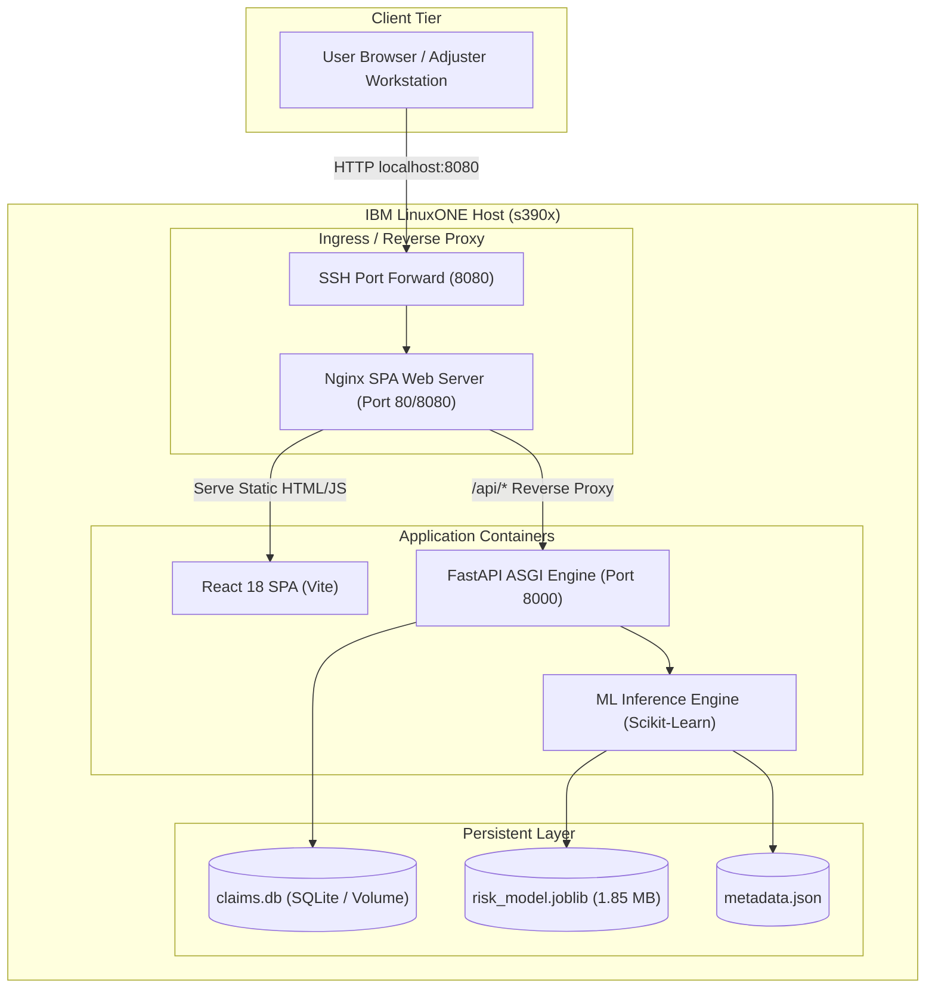

# IBM LinuxONE (s390x) Deployment & Operations Guide
## Real-Time Insurance Claim Risk Scoring — IBM Z Datathon 2026

**Role:** Member 4 — LinuxONE, DevOps & Deployment Engineer  
**Architecture Target:** IBM Z / LinuxONE (`s390x`) & `x86_64`  
**Host Environment:** Red Hat Enterprise Linux 9.8 (Plow) on IBM LinuxONE Community Cloud  
**Container Engine:** Rootless Podman 5.8 / Podman Compose / Docker  

---

## 1. System Architecture



---

## 2. LinuxONE Environment Verification

Our inspection on the live IBM LinuxONE Community Cloud host confirmed:

| Property | Detected System Value | Deployment Decision |
| :--- | :--- | :--- |
| **Architecture** | `s390x` (IBM Z mainframe) | Multi-arch Debian/UBI images; no x86_64 prebuilt binaries |
| **Operating System**| Red Hat Enterprise Linux 9.8 (Plow) | RHEL 9 standard toolchains |
| **User & Privileges**| `linux1` (`uid=1002`, non-root) | Unprivileged rootless container deployment |
| **Available RAM** | 6.2 GB available (7.3 GB total) | Easily handles ML inference and both services |
| **Disk Space** | 44 GB available (`/dev/dasda1`) | Sufficient for container images, datasets, and models |
| **Container Engine**| `podman 5.8.2` | Rootless Podman container orchestration |
| **Network Egress** | Direct outbound HTTPS (`github.com: 200 OK`) | Can pull git repositories and official multi-arch images |
| **Network Ingress** | SSH Port 22 open | SSH local port forwarding (`-L 8080:127.0.0.1:8080`) for secure zero-trust demo access |

---

## 3. Pre-Deployment Setup & Repository Sync

### 3.1 Clone the Team Repository on LinuxONE

Connect to your LinuxONE host:
```bash
ssh -o ServerAliveInterval=30 -o ServerAliveCountMax=5 -i skysds.pem linux1@148.100.108.169
```

Clone the repository:
```bash
git clone https://github.com/sakshi-07-sk/Insura.git
cd Insura
```

### 3.2 Model Artifact Placement

Because binary model files (`.joblib`) are excluded from Git to avoid repository bloat, transfer Member 1's trained artifact from your local machine to the LinuxONE host:

**From your local laptop (PowerShell):**
```powershell
scp -i "c:\Users\SAKSHI S K\OneDrive\Desktop\IBMZ\skysds.pem" "c:\Users\SAKSHI S K\OneDrive\Desktop\insura\backend\models\risk_model.joblib" linux1@148.100.108.169:~/Insura/backend/models/
```

Verify artifact placement on LinuxONE:
```bash
ls -lh ~/Insura/backend/models/risk_model.joblib
```
*(Expected size: ~1.85 MB)*

---

## 4. Environment Variables Configuration

Create the runtime `.env` file on the LinuxONE host:
```bash
cp .env.example .env
```

Default production settings configured in `.env`:
```ini
APP_ENV=production
LOG_LEVEL=INFO
DATABASE_URL=sqlite:////app/data/claims.db
MODEL_ARTIFACT_PATH=backend/models/risk_model.joblib
MODEL_METADATA_PATH=backend/models/metadata.json
ALLOW_MOCK_MODEL=false
CORS_ORIGINS=*
VITE_API_BASE_URL=/api
```

---

## 5. Deployment Options

### Option A: Automated Podman Deployment (Recommended)

Run the included automated deployment script:
```bash
chmod +x scripts/deploy_linuxone.sh scripts/verify_deployment.sh
./scripts/deploy_linuxone.sh
```

The script automatically:
1. Detects `s390x` architecture and validates `risk_model.joblib`.
2. Creates the private container bridge network `insura-net`.
3. Creates persistent storage volume `claim_data` for SQLite.
4. Builds the backend container (`python:3.11-slim` multi-arch).
5. Builds the frontend container (`node:20-slim` builder + `nginx:bookworm-slim`).
6. Starts the services and verifies HTTP readiness.

### Option B: Using Podman Compose / Docker Compose

If `podman-compose` is installed:
```bash
podman-compose up -d --build
```

To stop:
```bash
podman-compose down
```

### Option C: Native Fallback Deployment (No Containers)

If container privileges are restricted:
```bash
chmod +x scripts/run_native.sh
./scripts/run_native.sh
```

---

## 6. Accessing the Application & Running the Live Demo

Because IBM LinuxONE Community Cloud instances sit behind strict institutional firewall rules, the approved, secure method for accessing the web UI and API is **SSH Local Port Forwarding**.

### 6.1 Establish Port Forwarding from Local Laptop

Run this command in PowerShell or terminal on your laptop:
```powershell
ssh -L 8080:127.0.0.1:8080 -i "c:\Users\SAKSHI S K\OneDrive\Desktop\IBMZ\skysds.pem" linux1@148.100.108.169
```

### 6.2 Open the Web Application

With the SSH tunnel active, open your browser to:
- **ClaimGuard AI Dashboard:** [http://localhost:8080](http://localhost:8080)
- **FastAPI Interactive API Docs (Swagger):** [http://localhost:8080/docs](http://localhost:8080/docs)
- **Alternative ReDoc UI:** [http://localhost:8080/redoc](http://localhost:8080/redoc)

---

## 7. Verification & Smoke Testing

Run the automated smoke test script on the LinuxONE host:
```bash
./scripts/verify_deployment.sh
```

### Manual Verification Commands

**1. Service Liveness Check:**
```bash
curl -i http://127.0.0.1:8080/api/health
```
*Expected: HTTP 200 `{"status":"ok","service":"insurance-claim-risk-scoring-api",...}`*

**2. Model Readiness Probe:**
```bash
curl -i http://127.0.0.1:8080/api/model-info
```
*Expected: HTTP 200 with `"is_real_artifact_loaded": true` and `"mock_mode_active": false`.*

**3. Real Claim Scoring:**
```bash
curl -s -X POST http://127.0.0.1:8080/api/claims \
  -H "Content-Type: application/json" \
  -d '{
    "claim_id": "DEMO-CLM-101",
    "Month": "Jan", "WeekOfMonth": 2, "DayOfWeek": "Monday",
    "Make": "Honda", "AccidentArea": "Urban", "DayOfWeekClaimed": "Tuesday",
    "MonthClaimed": "Jan", "WeekOfMonthClaimed": 2, "Age": 34,
    "Fault": "Policy Holder", "PolicyType": "Sedan - All Perils",
    "VehicleCategory": "Sedan", "VehiclePrice": "20000 to 29000",
    "Deductible": 400, "DriverRating": 2,
    "Days_Policy_Accident": "more than 30", "Days_Policy_Claim": "more than 30",
    "PastNumberOfClaims": "none", "AgeOfVehicle": "3 years",
    "AgeOfPolicyHolder": "31 to 35", "PoliceReportFiled": "No",
    "WitnessPresent": "No", "AgentType": "External",
    "NumberOfSuppliments": "none", "AddressChange_Claim": "no change",
    "NumberOfCars": "1 vehicle", "Year": 2024, "BasePolicy": "All Perils"
  }' | jq .
```

**4. Data Persistence Test:**
```bash
curl -s http://127.0.0.1:8080/api/claims | jq .
```
Verify `DEMO-CLM-101` is returned.

---

## 8. Service Monitoring, Logs & Lifecycle

### Inspecting Running Services
```bash
podman ps
```

### Viewing Real-time Application Logs
```bash
# Backend logs
podman logs -f insura-backend

# Frontend / Nginx access logs
podman logs -f insura-frontend
```

### Restarting Services
```bash
podman restart insura-backend insura-frontend
```

### Stopping Services
```bash
podman stop insura-backend insura-frontend
```

---

## 9. Troubleshooting Guide

| Issue | Symptom | Diagnostic Step | Safe Resolution |
| :--- | :--- | :--- | :--- |
| **Model Not Loaded (HTTP 503)** | `/api/ready` reports error | `podman logs insura-backend \| grep -i model` | Ensure `risk_model.joblib` exists in `backend/models/` and re-run `./scripts/deploy_linuxone.sh`. |
| **Port Binding Permission Denied** | Podman error binding port 80 | `id -u` (returns 1002) | Use unprivileged port `8080` (already configured in `docker-compose.yml` and `scripts/deploy_linuxone.sh`). |
| **Nginx 502 Bad Gateway** | Accessing `/api/health` yields 502 | `podman logs insura-backend` | Check if backend crashed on startup or if `insura-net` container network is disconnected. |
| **SSH Tunnel Drops** | Browser loses connection | `ssh: Connection reset` | Add `-o ServerAliveInterval=30 -o ServerAliveCountMax=5` to your SSH command. |
| **Database Resets on Restart** | Previously scored claims vanish | Inspect container volumes: `podman volume ls` | Ensure `claim_data` volume is mounted to `/app/data` with `:Z` SELinux flag. |

---

## 10. Handover Notes for Team Members

- **Member 1 (ML Engineer):** The pipeline strictly loads your calibrated Random Forest model (`risk_model.joblib`). Thresholds `0.427` (Low) and `0.610` (High) are preserved.
- **Member 2 (Backend Engineer):** Database migrations and tables initialize automatically on startup via `lifespan`. All claim records persist in the SQLite volume.
- **Member 3 (Frontend Engineer):** The React SPA is bundled in production mode and served with client-side SPA routing (`try_files $uri $uri/ /index.html`). The UI directly queries `/api/*`, transparently forwarded to the backend.
- **Member 5 (Reviewer & Presenter):** Follow Section 6 to demonstrate live claim scoring on the LinuxONE mainframe during the presentation.
